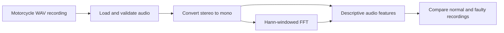

# Engine Fault Diagnosis via Audio Signal Analysis

**Educational DSP project · Motorcycle audio · Python and MATLAB**

> **Repository status — reconstructed reference implementation.** This project is based on the author's recollection, not the original source code or original recordings. It demonstrates descriptive signal analysis and normal-versus-faulty feature comparison; it is not a validated automatic fault classifier.

## Overview

This repository provides a small, reproducible workflow for exploring mobile-phone recordings of normal and faulty motorcycle engine sounds. It loads WAV audio, converts stereo to mono, applies a Hann window for frequency analysis, calculates an FFT magnitude spectrum and descriptive audio features, and compares feature values between recordings.

“Adaptive” in the recollected project description referred to comparing recordings made under different conditions. This repository does **not** claim to implement an LMS/RLS adaptive filter, machine learning, real-time diagnosis, or fault-type recognition.

## Project goals

- Inspect motorcycle audio recorded using a mobile phone.
- Compare descriptive features from recordings labelled `normal` and `faulty`.
- Provide a simple Python command-line interface and a MATLAB analysis function.
- Make assumptions, limitations, and the reconstructed status explicit.

## Processing workflow



The output is a collection of descriptive measurements—not a diagnosis. Features can change because of RPM, load, phone position, automatic gain control, background noise, or other recording differences.

## Features

The Python implementation reports RMS, zero-crossing rate, spectral centroid, spectral bandwidth, 85% spectral roll-off, dominant non-zero frequency, and mean/standard deviation summaries for 13 MFCC coefficients. MFCC extraction uses Librosa. The FFT uses a Hann window and reports a single-sided magnitude spectrum.

## Repository structure

```text
.
├── README.md
├── CONTRIBUTING.md
├── pyproject.toml
├── requirements.txt
├── src/engine_dsp/
│   ├── __init__.py
│   ├── audio.py
│   ├── features.py
│   ├── comparison.py
│   └── cli.py
├── tests/
├── matlab/analyze_engine_audio.m
├── examples/README.md
├── data/{normal,faulty}/.gitkeep
└── docs/
    ├── IMPLEMENTATION_STATUS.md
    ├── PROJECT_PLAN.md
    └── recording_guidelines.md
```

## Setup

Python 3.10 or newer is required.

```bash
python -m venv .venv
# Windows PowerShell: .venv\Scripts\Activate.ps1
# macOS/Linux:
source .venv/bin/activate
python -m pip install --upgrade pip
pip install -e ".[dev]"
```

To install from the pinned/minimal requirements list instead, use `pip install -r requirements.txt` (then `pip install -e .`).

## Use the Python CLI

Put WAV files in `data/normal/` and `data/faulty/` (audio is not included). The `analyze` command prints JSON features for one recording:

```bash
engine-dsp analyze data/normal/recording.wav
```

Compare two recordings:

```bash
engine-dsp compare data/normal/normal.wav data/faulty/faulty.wav
```

Analyze all WAV files in a dataset directory and write a CSV summary:

```bash
engine-dsp dataset data --output features.csv
```

Run the test suite with `pytest`. Commands accept WAV files; unsupported or malformed files produce an error rather than being silently interpreted.

## MATLAB

Open MATLAB at the repository root and run:

```matlab
result = analyze_engine_audio("data/normal/recording.wav");
disp(result.features)
```

The function uses MATLAB's `audioread`, `hann`, and FFT support. MFCC summaries are included when the Audio Toolbox `mfcc` function is available; otherwise the returned MFCC field is empty. The Python and MATLAB implementations are reference analyses and may differ in feature conventions or numerical details.

## Data and recording guidance

No original recordings, labels beyond the directory naming convention, exact sample rate, RPM/load metadata, or diagnostic thresholds were supplied. Keep recordings in WAV format, retain original files, and record the conditions for each take. For useful comparisons, keep RPM/load, phone position and distance, orientation, and environment as similar as practical. See [recording guidelines](docs/recording_guidelines.md).

Example layout:

```text
data/
├── normal/recording_01.wav
└── faulty/recording_01.wav
```

Do not commit private recordings or audio you do not have permission to share.

## Implementation status and provenance

| Item | Status |
| --- | --- |
| Motorcycle/mobile-phone audio; normal vs. faulty comparison | Author recollection |
| Python and MATLAB; DSP-only; no ML | Author recollection |
| Hann-windowed FFT and descriptive feature implementation | Included as a reconstructed reference implementation |
| MFCC summaries | Python via Librosa; MATLAB when Audio Toolbox `mfcc` is available |
| Original source code, recordings, exact conditions and thresholds | Not available |
| Validated classifier, fault-type recognition, diagnostic accuracy | Not implemented / not claimed |
| LMS/RLS filtering and real-time analysis | Future work only; not implemented |

See [implementation status](docs/IMPLEMENTATION_STATUS.md) and [project plan](docs/PROJECT_PLAN.md) for additional detail.

## Limitations and safety

- A feature difference does not prove a mechanical fault and does not identify a fault type.
- Acoustic features vary with RPM, engine load, microphone frequency response, distance, environment, and phone audio processing.
- The supplied project recollection does not include original recordings or a validated evaluation protocol; no accuracy or threshold is claimed.
- This is an educational DSP reference project, not a certified diagnostic instrument. **Do not use it to decide whether a motorcycle is safe to ride. Consult a qualified mechanic.**

## References and acknowledgements

The workflow is based on the project details and recollections supplied for this repository. MFCCs are a standard audio feature representation; the Python extraction is provided by [Librosa](https://librosa.org/). No original dataset or external engine-audio benchmark is included.

## License

No license has been selected for original work in this repository. Check the licenses of dependencies and any audio you add before reuse or redistribution.

## Author

**Vivekanand Naik** · [GitHub](https://github.com/vivekanandnaikk) · [LinkedIn](https://www.linkedin.com/in/vivekanand-naik)
