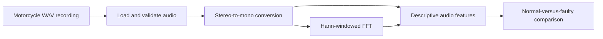

# Engine Fault Diagnosis via Audio Signal Analysis

**Author:** Vivekanand Naik · **Stack:** Python, MATLAB, digital signal processing

> **Project status — implementation available.** This repository contains a complete educational Python and MATLAB DSP workflow for analyzing motorcycle engine recordings and comparing normal-versus-faulty feature measurements.

## Overview

This project explores motorcycle engine audio recorded using a mobile phone. The workflow loads WAV recordings, converts stereo audio to mono, applies a Hann window for frequency analysis, calculates an FFT magnitude spectrum, extracts descriptive audio features, and compares the measurements between normal and faulty recordings.

The work is DSP-only and does not implement a machine-learning classifier or LMS/RLS adaptive filter. “Adaptive” in the original project concept refers to accounting for and comparing signals recorded under different conditions.

## Project goals

- Analyze motorcycle engine audio recorded with a mobile phone.
- Compare normal and faulty recordings using time-domain and frequency-domain features.
- Provide practical Python CLI and MATLAB implementations.
- Keep acquisition assumptions, limitations, and safety considerations visible.

## Processing workflow



The output is a collection of descriptive measurements, not a certified diagnosis. Feature values can vary with RPM, engine load, microphone position, phone processing, background noise, and environment.

## Features

The Python implementation reports:

- RMS amplitude
- Zero-crossing rate
- Spectral centroid
- Spectral bandwidth
- 85% spectral roll-off
- Dominant non-DC frequency
- Mean and standard deviation for 13 MFCC coefficients

The FFT uses a Hann window and produces a single-sided magnitude spectrum. MFCC extraction uses Librosa.

## Repository structure

```text
.
├── README.md
├── CONTRIBUTING.md
├── pyproject.toml
├── requirements.txt
├── src/engine_dsp/
│   ├── __init__.py
│   ├── audio.py
│   ├── features.py
│   ├── comparison.py
│   └── cli.py
├── tests/
├── matlab/analyze_engine_audio.m
├── examples/README.md
├── data/{normal,faulty}/.gitkeep
└── docs/
    ├── IMPLEMENTATION_STATUS.md
    ├── PROJECT_PLAN.md
    └── recording_guidelines.md
```

## Setup

Python 3.10 or newer is required.

```bash
python -m venv .venv
# Windows PowerShell:
.venv\Scripts\Activate.ps1
# macOS/Linux:
source .venv/bin/activate
python -m pip install --upgrade pip
pip install -e ".[dev]"
```

You may also use `pip install -r requirements.txt` followed by `pip install -e .`.

## Python commands

Place WAV recordings in `data/normal/` and `data/faulty/`.

Analyze one recording:

```bash
engine-dsp analyze data/normal/recording.wav
```

Compare a normal and faulty recording:

```bash
engine-dsp compare data/normal/normal.wav data/faulty/faulty.wav
```

Create a CSV summary for a dataset:

```bash
engine-dsp dataset data --output features.csv
```

Run tests:

```bash
pytest
```

## MATLAB

Open MATLAB at the repository root and run:

```matlab
result = analyze_engine_audio("data/normal/recording.wav");
disp(result.features)
```

The function uses `audioread`, `hann`, and FFT support. MFCC summaries are returned when MATLAB Audio Toolbox provides `mfcc`; otherwise the MFCC fields are empty and a warning is shown.

## Recording guidance

No recordings are distributed in this repository. Keep original WAV files and metadata for every take, including date, device, phone position, engine RPM/load when known, duration, and environment. For more meaningful comparisons, maintain consistent RPM, load, phone position, distance, orientation, and audio settings. See [recording guidelines](docs/recording_guidelines.md).

Example layout:

```text
data/
├── normal/
│   └── recording_01.wav
└── faulty/
    └── recording_01.wav
```

Do not commit private recordings or audio you do not have permission to share.

## Implementation status

| Item | Status |
| --- | --- |
| Motorcycle/mobile-phone audio analysis | Implemented workflow |
| Normal-versus-faulty feature comparison | Implemented |
| Python and MATLAB implementations | Included |
| Hann-windowed FFT and descriptive features | Included |
| MFCC summaries | Python via Librosa; MATLAB with Audio Toolbox |
| Audio recordings and metadata | Not distributed in this repository |
| Automatic fault-type classification | Not implemented |
| LMS/RLS adaptive filtering or real-time processing | Future work |

See [implementation status](docs/IMPLEMENTATION_STATUS.md) and [project plan](docs/PROJECT_PLAN.md).

## Limitations and safety

- Feature differences do not prove a mechanical fault or identify a specific fault type.
- Phone microphones, automatic gain control, compression, and noise reduction can affect results.
- Engine speed, load, warm-up state, distance, environment, and segmentation affect measured features.
- This project is educational and is not a certified diagnostic instrument.
- Do not use this repository to decide whether a motorcycle is safe to ride. Consult a qualified mechanic.

## References and acknowledgements

- [Librosa](https://librosa.org/) for Python MFCC extraction.
- NumPy and SciPy for numerical processing and FFT analysis.

## License

No license has been selected for original work in this repository. Check dependency licenses and obtain permission before redistributing added recordings or datasets.

## Author

**Vivekanand Naik** · [GitHub](https://github.com/vivekanandnaikk) · [LinkedIn](https://www.linkedin.com/in/vivekanand-naik)
